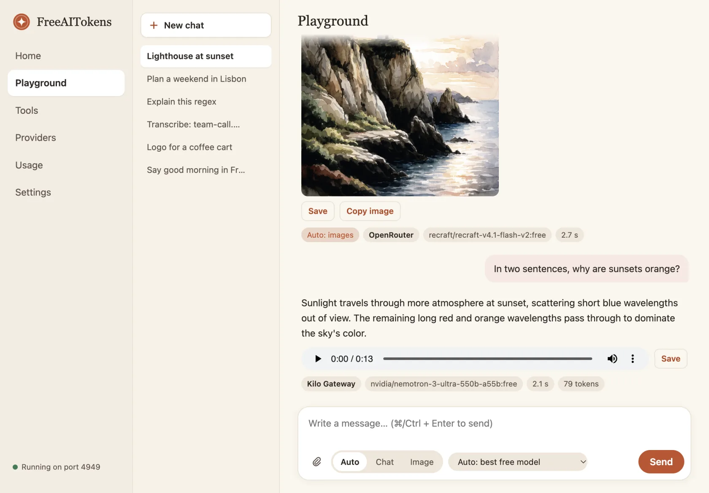

# freeaitokens

[Website](https://freeaitokens.co) · [Download the app](https://freeaitokens.co/download) · [Use it with your tools](#use-it-with-your-tools)

Up to about **7 billion free AI tokens a month**. AI providers each give a small free allowance; freeaitokens adds many of them together behind one local endpoint, picks the best model available for every request, and moves to another one when a provider hits its limit. Use it from your own scripts and apps, chat clients, editors or coding agents.

```bash
npx freeaitokens
```

That works straight away, with no account, on providers that need no key. Each free key you add raises the total:

```bash
npx freeaitokens add
```

Prefer an app? The [desktop app](#desktop-app) runs the same endpoint from your menu bar or system tray, with a playground for chat, images and speech.



The 7 billion figure adds up the free limits providers publish, counting 2,000 tokens a request where only a request limit is published. Most of it comes from a few large allowances (Cerebras alone is most of it), and you get it only with a key for each provider. Several providers publish no limit and count as zero.

## Use it with your tools

| Tool | How |
|---|---|
| Claude Code | `npx freeaitokens claude` (any Claude Code arguments work after it) |
| Codex | `npx freeaitokens codex` |
| Gemini CLI | `npx freeaitokens gemini` |
| OpenCode | `npx freeaitokens setup opencode`, then pick the model `freeaitokens/free` |
| Kilo Code CLI, Qwen Code, Goose, Aider | `npx freeaitokens kilo` / `qwen` / `goose` / `aider` |
| Zed, JetBrains AI, VS Code (Copilot custom endpoint) | `npx freeaitokens setup zed` / `jetbrains` / `vscode` prints what to paste |
| Continue, Cline, Crush, Roo Code | `npx freeaitokens setup cline` (or the tool's name) prints the values |
| Anything OpenAI-compatible | Base URL `http://127.0.0.1:4949/v1`, model `free`, key from the startup banner |
| Anthropic, Gemini or Ollama clients | Base URL `http://127.0.0.1:4949`, the same key |

The launchers only affect that one session and write nothing to your tool's config. Run the tool normally and it uses your own account as before. `setup opencode` adds a provider next to your existing ones and keeps a backup; `--undo` restores it.

## What it does

- **Picks a model per request.** It only considers models that can handle the request: enough context for the conversation so far, tool calling when the tool needs it, images when there are images. Among those it prefers better models that have been fast and reliable for you, and it stays on the same model through a conversation unless another is clearly better.
- **Fails over.** On a rate limit, server error or timeout it tries the next model before your tool sees anything. If everything is busy and capacity returns within 30 seconds, it waits; otherwise it tells you when capacity returns.
- **Tracks free limits** per provider, model and key, by the minute and by the day, and corrects itself from the limits providers report.
- **Speaks five formats**: OpenAI chat completions, Anthropic Messages (Claude Code), OpenAI Responses (Codex), Gemini (Gemini CLI) and Ollama (`/api/chat`, for local-model clients that can send a key).
- **Not only chat.** The same endpoint takes the OpenAI routes for embeddings (`/v1/embeddings`), plain completions such as editor autocomplete (`/v1/completions`), image generation (`/v1/images/generations`), text to speech (`/v1/audio/speech`), transcription (`/v1/audio/transcriptions`) and video (`/v1/videos`, then poll `/v1/videos/<id>` and download `/v1/videos/<id>/content`). Each goes to a free provider that offers that kind of model, with the same failover and limit tracking. The body is passed through as sent, apart from the model name, so options a provider does not support may be refused by it. Video jobs are remembered only while freeaitokens runs.

  - **Free today:** embeddings (Gemini, OpenRouter, SEA-LION, Cloudflare, OVH), completions (Cerebras, OpenRouter, OVH), images (Cloudflare Flux, OpenRouter), text to speech (Groq, OpenRouter, Cloudflare), transcription (Groq, Cloudflare, OVH). No provider offers free video yet, so `/v1/videos` answers that none is set up.
  - **Embeddings:** vectors from different models cannot be compared. The response names the model used; send that name as `model` (for example `gemini-embedding-001` or `ovh/bge-m3`) and every later request stays on it instead of switching.
  - **Cloudflare** images, speech and transcription use Cloudflare's own format, which freeaitokens converts: an image comes back as one `b64_json` (size and count are not passed on), speech voices are Aura's (`luna`, `asteria`, `orion`…; others get the default), and transcriptions return `text` (or `response_format` `text` or `vtt`).
  - **Groq text to speech** works only after you accept the model's terms in the Groq console. Output is WAV, at most 200 characters per request.

## Providers

| Provider | Key needed | Notes |
|---|---|---|
| Kilo Gateway | No | About 200 requests an hour per IP. Free prompts may be used for training. |
| Groq | Free key | |
| Cerebras | Free key | |
| OpenRouter | Free account | One-click connect in the browser. About 50 free requests a day. |
| Google Gemini | Free key | Google's terms limit the API to professional or business use. |
| SEA-LION | Free trial key | 10 requests a minute. Content may be used to improve the service. |
| Typhoon | Free key | A research showcase: usage data is collected to improve the models. |
| NVIDIA NIM | Free key | A trial for prototyping and testing, not production use. |
| Z.ai (GLM) | Free key | Only the Flash models are free. |
| OVH AI Endpoints | No | About 2 requests a minute per IP for each model. |
| Cloudflare Workers AI | Free account | 10,000 free Neurons a day, shared by chat, embeddings, images, speech and transcription. `add` asks for your Account ID and an API token. |

Resellers. Their models are rated below most of the providers above, so they are mostly a fallback. `freeaitokens add` shows each one's caveats before you sign up.

| Provider | Key needed | Notes |
|---|---|---|
| Nabh Cloud | Free key | GPT OSS 20B only, 500 requests a day. |
| KiosAPI | Free key | Small daily quota; amounts not published. |
| Kenari | Free key | 50 requests a day per free model. No company named. |
| Plugsky | Free key | 100 requests a day. The free model's underlying model is not disclosed. |
| ZRO (MoonMath) | Free key | Daily DeepSeek V4.1 Flash; amount not stated. |
| Requesty | Free key | 200 requests a day. May train on free-plan content. |
| BazaarLink | Free key | Small daily allowance. Some requests are kept in full. |
| Logfare | Free key + Discord | 5,000 requests a day. Logs everything, used for evals unless you opt out. |
| CheapLLM | Free key | Free during beta, then very small hourly limits. |
| BlockRun | Free key | About 300 requests an hour per IP. |
| Electron Hub | Free key | `:free` models only. Providers behind them may train on prompts. |
| Septor Labs | Free key | 50 requests a day. Routes to third-party aggregators that may keep prompts. |
| Routeway | Free key | Operator not named; requests are scanned before routing. |
| api.airforce | Free key | 1 request a minute. Logs IPs and usage. |
| AI Horde | Free key | Volunteer-run and slow, no tool calls; volunteers can see prompts. |
| LLM7 | Free key | Small operator; free limits and data handling not published. |

The provider list updates itself. A small service checks every provider every 6 hours, drops models that have gone and adds new free ones, then publishes a signed list. freeaitokens checks for it at most every 6 hours, only accepts it if the signature is valid and every provider's address, key page and sign-up steps match this repository, and otherwise keeps the list it has. Set `FREEAITOKENS_CATALOGUE=bundled` to use only the list built into the package.

Some sign-up links may be referral links. `freeaitokens add` always marks them "(referral link)" and shows the provider's own key page next to them.

`freeaitokens add` opens each provider's key page, shows the steps, and can pick the key up from your clipboard when you copy it (only during that step, and only if you agree). Keys are tested before they are saved, and stored in your system keychain. Where there is no keychain (some Linux servers, Termux), they go in a file only you can read, and it says so.

`freeaitokens list` shows what you have and what is left today. `freeaitokens remove <provider>` deletes a key.

## Desktop app

The tray app in [`desktop/`](desktop) runs the same endpoint without a terminal. Its menu shows the endpoint, copies it and the local token, lists each provider with what is left today, opens a window to add keys, and can start at login. Builds for macOS, Windows and Linux are attached to [GitHub releases](https://github.com/timchosen/freeaitokens/releases). They are not code-signed yet, so macOS and Windows warn the first time you open them.

On macOS the app is a different program from the `freeaitokens` command, so the first time it reads keys the command saved, macOS asks once per key whether to allow it. Choose Always Allow.

## Paid keys

Paid keys can sit below the free ones as a last resort. They are used only when no free model can serve the request, each paid request is printed, and there is a daily cap (200 by default, `--paid-cap <n>`). `--free-only` turns them off.

## Rules

Free tiers exist for developers to try things. Using them through this tool is still governed by each provider's terms:

- use your own keys, one account per provider;
- never share your endpoint with other people or resell access;
- don't run a production service on free tiers.

The endpoint listens on `127.0.0.1` only and needs the local token from the startup banner.

## Not supported yet

- **Cursor**: it sends custom-endpoint traffic through its own servers, which cannot reach a local address.
- **The ChatGPT app**: it cannot use a custom endpoint.
- Image editing, translation of audio, realtime voice; a dashboard.
- Codex's connected-app (MCP) tools and web search are not passed to free models: they add more context than free models accept.

## Website

The site at [freeaitokens.co](https://freeaitokens.co) lives in [`site/`](site). `npm run build` there writes `site/dist`; `npm run deploy` publishes it to Cloudflare. If you fork it, change [`site/site.config.json`](site/site.config.json) (your repo, domain, donation link) and the routes in `site/wrangler.jsonc`; nothing else names the owner.

## Development

```bash
npm install
npm test
npm run build
npx tsx scripts/smoke.ts   # one live request per usable provider
```

## Licence

MIT.
